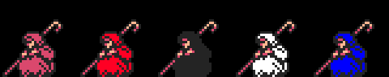
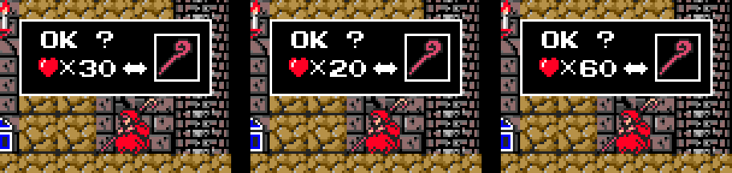
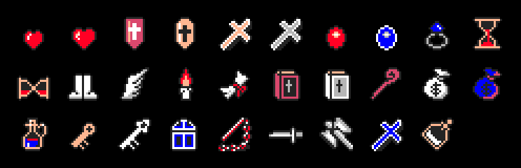

# The game

Simon Belmont walks into Dracula's castle with a whip and has to reach him.
The castle is **19 stages**: the courtyard at the gate (stage 0) and eighteen
more, grouped in **six blocks of three**. Each block ends with a boss. That
makes **156 rooms**, and each one is seen whole: there is no scrolling here,
you go from one room to the next through the sides, the top and the bottom.

Every picture on this page is **drawn from the bytes of the ROM** with the
tools in `tools/`, which follow the cartridge's own steps, and checked against
openMSX dumps (MSX2, `C-BIOS_MSX2_EU`). Under each one it says which table it
comes from.

## The title screen

The same cartridge carries **two titles**: *Vampire Killer* and
*悪魔城ドラキュラ* (*Akumajō Dracula*). It picks one by reading BIOS byte
0x002B, the one that says which country the computer is from (p00:4D9E). Both
come from the cartridge and both are checked: `coteja.py titulo`, 4 dumps
(curtain and title, on a European and a Japanese machine) with **0 bytes
different** on screen and in the palette.

Before the title, the Konami logo is drawn on page 1 of the VRAM and p01:624C
copies it to page 0 one line at a time, like a curtain.

## The castle

The 19 stages in place, each on its own grid. A room is **8 × 6 blocks of
32 × 32** pixels (bank 11: 156 pointers from 0x6013), and each block is 4 × 4
tiles of 8 × 8 (0x7EBB, one per stage). Of its 24 rows of tiles, 22 are
drawn, from y 32 (under the status bar): the first two are never seen. The
tiles are uploaded to page 1 of the VRAM when the stage starts, 191 per stage
from banks 4 to 8 (table 0x5742), and the palette is built in layers: the
scene's, the base, the stage's and the room's (0x9AB0).

**Check**: `coteja.py habitaciones` compares the 156 rooms with 156 openMSX
dumps, one per room: **0 with differences**. The probe
(`tools/omsx_habitacion.tcl`) sets the stage and the room in RAM and dumps the
VRAM when the cartridge switches the screen on.

Each room's exits are at 0xB9D3 (bank 13): one nibble per side.
`coteja.py mapa` walks them all: 22 are one-way, and all of them are drops or
the way into the boss except two, (13, 11) → 9 and (17, 10) → 11.

### A stage, with what it hides

Each stage has its own sheet (`docs/imagenes/fase_00.png` to `fase_18.png`),
with the secrets marked. This is stage 1:

What each room hides is in a list in bank 14 (0x8000, one pointer per block
of three stages). Each entry carries the position and, in the top three bits
of the second byte, what it is. The whole castle has **620**:

| what | how many | how it is drawn |
|---|---|---|
| candles | 365 | row 0x70 of page 1, two frames taking turns |
| breakable blocks | 92 | 4 × 4 tiles from 0x8792 or 0x87A6 (p02:86CA) |
| items in plain sight | 76 | rows 0x50 and 0x60 of page 1, with transparency |
| chests | 71 | item 0x19 |
| vendors in plain sight | 16 | the white old man, 32 × 32 from page 1 (96, 0xA0) |

What comes out of a candle or a block, or out of a chest, is in the low bits.
The most common: 129 hearts, 100 big hearts, 77 keys and 21 white keys. In 52
places what comes out is **an enemy** (type 0x15: p02:8AD0 takes it from the
table at 0x8AF0).

Each stage's exit door is at 0xBB61 (bank 13): room, y and x. The cartridge
draws it from the ROM, six 8 × 8 pieces one under the other.

### The vendors

There are **33 vendors**: 16 in plain sight and 17 inside breakable blocks.
The vendor is a 32 × 32 hooded old man, the same mould (0xBDA7) that
p00:54F0 colours five times on row 0xA0 of page 1. He comes out white; when
hit he blinks with the black one and stays in the colour of what comes
(0x9320): red, the shop; pink, hearts; blue, 0xD012; white, nothing or he
leaves. Each one sells one thing (0x5B0B): full life, dagger, boomerang cross, shield, flask,
staff, hourglass, the candle that marks the blocks… But **they do not always
sell**: what happens depends on their class (two bits of the secret) and on
**how many times you have hit them**. Each hit adds one (p02:8115), and the
table at 0x9300 says what each hit brings, eight per class (p02:92BB). From
the eighth on, the last one repeats:

| class | vendors | hit 1 | 2 | 3 | 4 | 5 | 6 | 7 | 8 |
|---|---|---|---|---|---|---|---|---|---|
| 0 | 10 | shop | +5 ♥ or nothing | +5 ♥ or nothing | +5 ♥ or nothing | −5 ♥ or nothing | −5 ♥ or nothing | nothing | leaves |
| 1 | 7 | shop | +5 ♥ | +5 ♥ | 0xD012 +1 | nothing | nothing | nothing | leaves |
| 2 | 6 | +5 or −5 ♥ | +5 or −5 ♥ | shop | nothing | nothing | nothing | 0xD012 −1 | leaves |
| 3 | 10 | nothing | nothing | nothing | nothing | shop | +5 ♥ | nothing | leaves |

Where it says "or", the Z80's R register draws lots. "Leaves" gives 5,000
points and the vendor does not come back. The hit count is cleared at the
start of every life (p00:5AAF). If the shop opens and you leave without
buying, that hit does not count when you come back (p02:925B).

**Prices, in hearts, depend on the books** (0xC702, p02:9418): with the white
one, cheaper; with the red one, dearer. You carry one or the other, never
both.

The window (p02:9397) opens 0x18 dots above the vendor and to his left:
0x50 × 0x20, cleared and framed in colour 0x0E; inside, the labels at 0x9485
and 0x948A, the two-digit price and the item in its frame. Fire or space
buys; the other button, no hearts, or 0x14 spells of 32 frames close it.
**Check**: `coteja.py tienda`, six dumps of the open shop
(`tools/lanza_tiendas.sh`), 0 dots different.

| what it sells | no book | white book | red book |
|---|---|---|---|
| dagger | 50 | 30 | 90 |
| full life | 40 | 15 | 80 |
| hourglass | 40 | 20 | 80 |
| staff | 30 | 20 | 60 |
| flask | 30 | 10 | 50 |
| shield | 20 | 10 | 80 |
| boomerang cross | 20 | 10 | 80 |
| red shield | 20 | 10 | 60 |
| candle | 20 | 15 | 60 |

Seen in openMSX hit by hit, with one vendor of each class.

### The items

The item of type t is drawing t − 1 of page 1: the first sixteen on row 0x50
and the rest on 0x60 (p02:8CC1). What each one does is handed out by
p02:8D3E; the names are those of its drawing.

| type | item | what it does |
|---|---|---|
| 0x01 | heart | one heart |
| 0x02 | big heart | five hearts |
| 0x03 | red shield | for 16 hits (0xC441) |
| 0x04 | shield | for 16 hits (0xC441) |
| 0x05 | white cross | clears what is in the room, and the vendors leave (p02:8DC2) |
| 0x06 | grey cross | the weapon counter to 0x96 frames (0xC440) |
| 0x07 | red orb | 8 of life |
| 0x08 | blue orb | invincible for 0x96 frames (0xC43A) |
| 0x09 | ring | kills on touch while it lasts (0xC434) |
| 0x0A | hourglass | a bit of what he carries (0xC701, bit 6) |
| 0x0B | bow | counters last 0xF0 instead of 0x96 (0xC431, bit 2) |
| 0x0C | boots | a bit (0xC431, bit 3) |
| 0x0D | wings | a bit (0xC431, bit 4) |
| 0x0E | candle | marks the breakable blocks (0xC702, bit 0) |
| 0x0F | scroll | three uses of the map with F2 (0xC70F) |
| 0x10 | red book | the shop, dearer (0xC702, bit 6) |
| 0x11 | white book | the shop, cheaper (0xC702, bit 7) |
| 0x12 | staff | a bit (0xC431, bit 1) and another of what he carries |
| 0x13 | white bag | 5,000 points |
| 0x14 | blue bag | 1,000 points |
| 0x15 | — | an enemy (p02:8AD0) |
| 0x16 | bottle | full life |
| 0x17 | key | a bit of what he carries (bit 1) and 0xC700 = 1 |
| 0x18 | white key | a bit of what he carries (bit 0) |
| 0x19 | chest | what it hides |
| 0x1A-0x1D | weapons 1 to 4 | chain whip, dagger, axe and boomerang cross: to 0xC416 and to the scoreboard (p02:8D70) |
| 0x1E | flask, weapon 5 | a bit of what he carries (bit 3, p02:8D8D) |

## Simon

Simon is two halves: **legs** (0xC42E) and **body** (0xC42F), each with its
own 16 × 16 mode 2 sprites, coloured line by line. There are 40 leg frames
and 36 body frames (tables at p01:7985 and p01:79D5), and the code combines
them according to what he is doing: walking, crouching, jumping, climbing
stairs, whipping.

**Check**: `coteja.py simon`, 156 dumps, **0 with differences** (in 11 Simon
is one frame further on and in 5 he still has the previous pose's patterns:
those are checked against that pose).

## The enemies

One row per type. The things in each room are at 0x8668 (bank 14): type and
position. When it creates one, the cartridge reads how many sprites it has
(0x6058), in which colours (0x6084) and how much life (0x60E1); every frame,
its drawing picks in 0xB473 (bank 6) where each sprite goes. The frames in
each row are the ones seen in openMSX (250 frames per room), and each one is
checked against its table: `coteja.py enemigos` gives **58,430 samples with
their drawing**, 959 with another frame's, 257 read halfway and 98 halfway
through being created; **none unexplained**.

The names go **by the drawing**; where the drawing does not settle it, it is
described:

| type | what it is | stages | life |
|---|---|---|---|
| 0x01 | purple-robed figure with its arms up | 1, 2 | 1 |
| 0x02 | fishman | 2 | 1 |
| 0x03 | hunched red creature | 10 | 2 |
| 0x04 | blue outline | 1, 2 | 1 |
| 0x05 | panther | 1, 3 | 1 |
| 0x06 | knight with a spear | 4, 5 | 4 |
| 0x07 | flying white head | 6 | 2 |
| 0x08 | the same, orange | 4 | 1 |
| 0x09 | red skeleton that falls apart | 13, 14 | 2 |
| 0x0A | pillar of skulls | 6, 8, 9 | 8 |
| 0x0B | skeleton | 7, 8, 9, 13, 17 | 4 |
| 0x0C | bat | 7, 8 | 1 |
| 0x0D | hunchback | 7, 9, 11, 13, 17, 18 | 1 |
| 0x0E | bone dragon | 11, 12 | 12 |
| 0x0F | eagle | 11 | 8 |
| 0x10 | orange knight | 14, 15, 17, 18 | 8 |
| 0x1F | blue outline, with other frames | 3, 4 | 1 |
| 0x20 | bubbles | 2, 10 | 1 |
| 0x23 | hunchback the eagle brings | 11 | 1 |

Type 0x21 (stage 10) has its row, but it comes out empty: see
[Open questions](OPEN-QUESTIONS.md).

### The bone dragon

Type 0x0E does not use the 0xB473 table: its eight sprites are placed with
tables of their own in bank 3: pattern and colour (0xAB0E), x (0xAB1E) and
eight height records (0xAAAD). In the check, 1,347 samples fall on one height
record and 649 between two; none unexplained.

## The six bosses

| block | stage | boss | type | life |
|---|---|---|---|---|
| 1 | 3 | giant bat | 0x12 | 16 |
| 2 | 6 | Medusa | 0x13 | 16 |
| 3 | 9 | two mummies | 0x14 | 16 |
| 4 | 12 | Frankenstein's monster, with a hunchback (0x18) | 0x15 | 32 |
| 5 | 15 | Death | 0x16 | 32 |
| 6 | 18 | Dracula | 0x11 | 32 |

They are on the enemies sheet, each in its row. After the boss, game state 8
moves on to the next block.

### Dracula, whole

Dracula does not fit in sprites. The **head** is a sprite, but the **body** is
drawn by the VDP: the cartridge saves the background at (0x80, 0x80) of page
1 and copies the body onto the screen from page 1 (x 0, 32, 64 or 96, y 0x80)
with LMMM and transparency (p03:AD80, p03:AD93). **Check**: `coteja.py
dracula`, 4 dumps (one per frame), 0 bytes different on screen, saved
background, sprites and patterns.

## What they throw

What the enemies throw goes in **another list**, the one at 0xD700, with its
own type numbers (p02:9E5C; the parameters of each, at 0xA08F): fireballs
(from the giant bat, the pillar of skulls, Dracula and in the monster's
room), the skeleton's bones, Medusa's snakes, Death's sickles and the orange
knight's axes.

## The ending

After Dracula, p01:66BA scrolls up a text line by line with VDP register 23
(the vertical scroll), to music 0x8E. The 41 lines are in banks 5 and 8, with
the pointer table at 0x678E: each one carries the moment it appears, the
column and the text in ASCII. The font is completed by p00:53DE with letters
from bank 14, where “:” is drawn as a full stop and “;” as an apostrophe; here
it is as it looks:

    SO THE BRAVE YOUNG MAN
    PUT DRACULA INTO DEEP
    SLEEP AGAIN AND THE TOWN
    RESTORED ITS PEACE.

    LET'S PRAY THAT THE EVIL
    MIND OF HUMANBEINGS WILL
    NOT LET DRACULA COME TO
    LIFE EVER AGAIN....

And the STAFF:

| | |
|---|---|
| GAME DESIGNER | A. NAGATA |
| PROGRAMMER | A. HARIMA, I. AKADA, K. NAGAE |
| SOUND PROGRAMMER | H. SHIKAMA |
| GRAPHIC DESIGNER | S. IWAMOTO, N. MATSUI, K. MIZUTANI, A. FUJIMOTO |
| SOUND EFFECT BY | K. UEHARA |
| MUSIC BY | K. YAMASHITA, S. TERASHIMA |
| ART DESIGNER | F. HAYAKAWA |
| ASSISTANT PROGRAMMER | K. TOYOHARA, T. OKA, H. EDA, T. OHTSUKA, T. DANJYO |
| SPECIAL THANKS | K. HIRAOKA, FC. TEAM |
| PRODUCED BY | AKIHIKO NAGATA |
| PRESENTED BY | KONAMI |

When it ends, p01:6701 raises 0xD012, up to 2.
