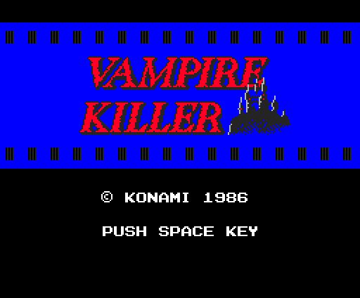
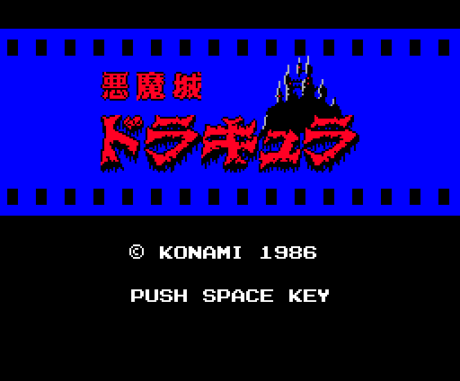
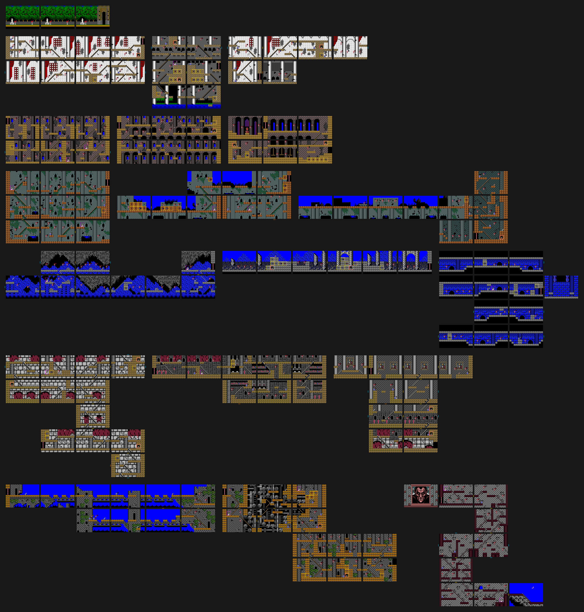
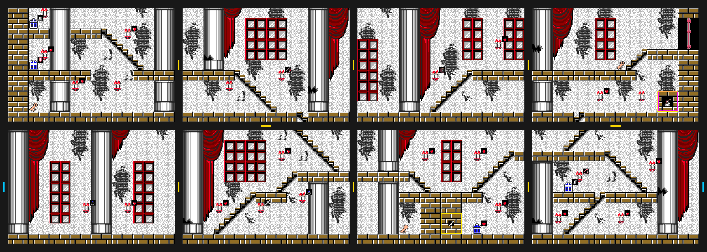
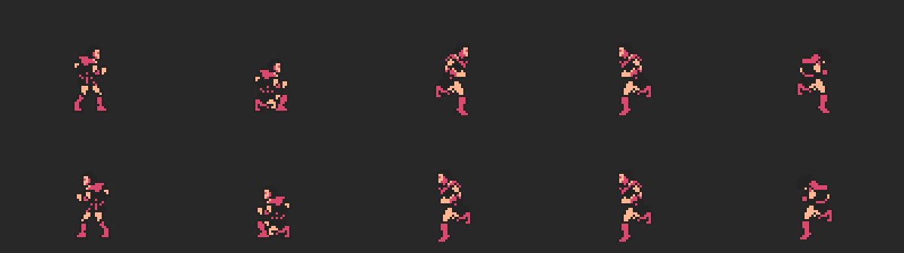
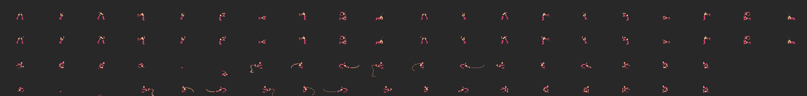
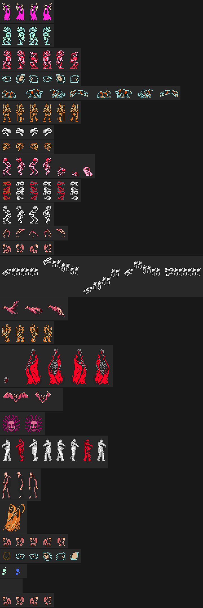
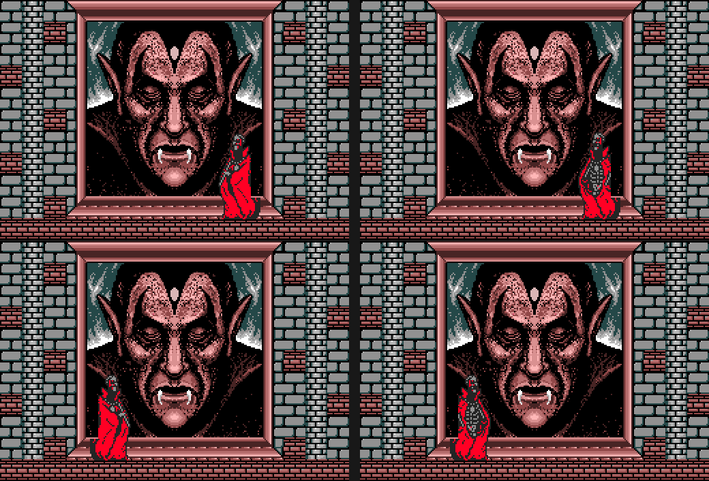
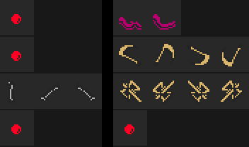

# El juego

Simon Belmont entra en el castillo de Drácula con un látigo y tiene que
llegar hasta él. El castillo son **19 fases**: el patio de la entrada (la fase
0) y dieciocho más, agrupadas en **seis bloques de tres**. Cada bloque acaba
con un jefe. En total, **156 habitaciones**, y cada una se ve entera: aquí no hay desplazamiento, se pasa de una habitación a otra por
los lados, por arriba y por abajo.

Todas las imágenes de esta página están **dibujadas desde los bytes de la
ROM** con las herramientas de `tools/`, que siguen los pasos del propio
cartucho, y cotejadas contra volcados de openMSX (MSX2, `C-BIOS_MSX2_EU`).
Debajo de cada una se dice de qué tabla sale.

## La pantalla de título

El mismo cartucho lleva **dos títulos**: *Vampire Killer* y *悪魔城ドラキュラ*
(*Akumajō Dracula*). Elige uno leyendo el byte 0x002B de la BIOS, el que dice
de qué país es el ordenador (p00:4D9E). Los dos salen del cartucho y los dos
están cotejados: `coteja.py titulo`, 4 volcados (telón y título, en máquina
europea y japonesa) con **0 bytes distintos** en pantalla y paleta.

Antes del título, el logotipo de Konami se pinta en la página 1 de la VRAM y
p01:624C lo va copiando a la página 0 línea a línea, como un telón.

## El castillo

Las 19 fases en su sitio, cada una con su rejilla. Una habitación son **8 × 6
bloques de 32 × 32** puntos (banco 11: 156 punteros desde 0x6013), y cada
bloque, 4 × 4 dibujos de 8 × 8 (0x7EBB, uno por fase). De sus 24 filas de
dibujos se pintan 22, desde la y 32 (debajo del marcador): las dos primeras
no se ven. Los dibujos se suben a
la página 1 de la VRAM al entrar en la fase, 191 por fase desde los bancos 4 a
8 (tabla 0x5742), y la paleta se monta por capas: la de la escena, la base, la
de la fase y la de la habitación (0x9AB0).

**Cotejo**: `coteja.py habitaciones` compara las 156 habitaciones con 156
volcados de openMSX, uno por habitación: **0 con diferencias**. La sonda
(`tools/omsx_habitacion.tcl`) pone la fase y la habitación en la RAM y vuelca
la VRAM cuando el cartucho enciende la pantalla.

Las salidas de cada habitación están en 0xB9D3 (banco 13): un nibble por lado.
`coteja.py mapa` las recorre todas: 22 son de ida sin vuelta, y todas son
caídas o la entrada al jefe menos dos, (13, 11) → 9 y (17, 10) → 11.

### Una fase, con lo que esconde

Cada fase tiene su lámina (`docs/imagenes/fase_00.png` a `fase_18.png`), con
los secretos marcados. Esta es la fase 1:

Lo que esconde cada habitación está en una lista del banco 14 (0x8000, un
puntero por bloque de tres fases). Cada entrada lleva la posición y, en los
tres bits altos del segundo byte, qué es. En todo el castillo hay **620**:

| qué | cuántos | cómo se pinta |
|---|---|---|
| velas | 365 | fila 0x70 de la página 1, dos dibujos que se turnan |
| bloques que se rompen | 92 | 4 × 4 dibujos de 0x8792 o 0x87A6 (p02:86CA) |
| objetos a la vista | 76 | filas 0x50 y 0x60 de la página 1, con transparencia |
| cofres | 71 | el objeto 0x19 |
| puertas con vendedor | 16 | 32 × 32 de la página 1 (96, 0xA0) |

Lo que sale al romper una vela o un bloque, o al abrir un cofre, lo dicen los
bits bajos. Lo más repetido: 129 corazones, 100 corazones grandes, 77 llaves y
21 llaves blancas. En 52 sitios lo que sale es **un enemigo** (el tipo 0x15:
p02:8AD0 lo saca de la tabla de 0x8AF0).

La puerta de salida de cada fase está en 0xBB61 (banco 13): habitación, y y x.
El cartucho la pinta desde la ROM, seis piezas de 8 × 8 una debajo de otra.

### Los vendedores

Tras 16 puertas, y dentro de 17 bloques, hay **33 vendedores**. Cada uno
vende una cosa (0x5B0B): vida llena, daga, cruz que vuelve, escudo, frasco,
bastón, reloj de arena, la vela que marca los bloques… Pero **no siempre
venden**: lo que pasa depende de su clase (dos bits del secreto) y de
**cuántas veces se le ha pegado**. Cada golpe suma uno (p02:8115), y la tabla
de 0x9300 dice qué toca en cada golpe, ocho por clase (p02:92BB). A partir del
octavo se repite el último:

| clase | vendedores | golpe 1 | 2 | 3 | 4 | 5 | 6 | 7 | 8 |
|---|---|---|---|---|---|---|---|---|---|
| 0 | 10 | tienda | +5 ♥ o nada | +5 ♥ o nada | +5 ♥ o nada | −5 ♥ o nada | −5 ♥ o nada | nada | se va |
| 1 | 7 | tienda | +5 ♥ | +5 ♥ | 0xD012 +1 | nada | nada | nada | se va |
| 2 | 6 | +5 o −5 ♥ | +5 o −5 ♥ | tienda | nada | nada | nada | 0xD012 −1 | se va |
| 3 | 10 | nada | nada | nada | nada | tienda | +5 ♥ | nada | se va |

Donde dice «o», lo sortea el registro R del Z80. «Se va» da 5.000 puntos y el
vendedor no vuelve. La cuenta de golpes se borra al empezar cada vida
(p00:5AAF). Si se abre la tienda y se sale sin comprar, al volver ese golpe no
cuenta (p02:925B).

**Los precios, en corazones, dependen de los libros** (0xC702, p02:9418): con
el blanco, más baratos; con el rojo, más caros. Se lleva uno u otro, nunca los
dos.

| lo que vende | sin libro | libro blanco | libro rojo |
|---|---|---|---|
| daga | 50 | 30 | 90 |
| vida llena | 40 | 15 | 80 |
| reloj de arena | 40 | 20 | 80 |
| bastón | 30 | 20 | 60 |
| frasco | 30 | 10 | 50 |
| escudo | 20 | 10 | 80 |
| cruz que vuelve | 20 | 10 | 80 |
| escudo rojo | 20 | 10 | 60 |
| vela | 20 | 15 | 60 |

Visto en openMSX golpe a golpe, con un vendedor de cada clase.

## Simon

Simon son dos mitades: **piernas** (0xC42E) y **cuerpo** (0xC42F), cada una
con sus sprites de 16 × 16 en modo 2, con el color por línea. Hay 40 dibujos
de piernas y 36 de cuerpo (tablas p01:7985 y p01:79D5), y el código los combina
según lo que hace: andar, agacharse, saltar, subir escaleras, azotar.

**Cotejo**: `coteja.py simon`, 156 volcados, **0 con diferencias** (en 11 Simon
está un cuadro más allá y en 5 aún lleva los patrones de la pose anterior: se
comprueban contra esa).

## Los enemigos

Una fila por tipo. Las cosas de cada habitación están en 0x8668 (banco 14):
tipo y posición. Al crear una, el cartucho lee cuántos sprites lleva (0x6058),
de qué color (0x6084) y cuánta vida (0x60E1); cada cuadro, su dibujo elige en
0xB473 (banco 6) dónde va cada sprite. Los cuadros de cada fila son los que se
vieron en openMSX (250 cuadros por habitación), y cada uno se coteja con su
tabla: `coteja.py enemigos` da **58.430 muestras con su dibujo**, 959 con el
de otro cuadro, 257 leídas a medias y 98 a medio crear; **ninguna sin
explicar**.

Los nombres son **por el dibujo**; donde el dibujo no lo deja claro, se
describe:

| tipo | qué es | fases | vida |
|---|---|---|---|
| 0x01 | figura de túnica morada con los brazos en alto | 1, 2 | 1 |
| 0x02 | hombre pez | 2 | 1 |
| 0x03 | criatura roja encorvada | 10 | 2 |
| 0x04 | silueta azul | 1, 2 | 1 |
| 0x05 | pantera | 1, 3 | 1 |
| 0x06 | caballero con lanza | 4, 5 | 4 |
| 0x07 | cabeza blanca que vuela | 6 | 2 |
| 0x08 | la misma, naranja | 4 | 1 |
| 0x09 | esqueleto rojo que se desmonta | 13, 14 | 2 |
| 0x0A | columna de calaveras | 6, 8, 9 | 8 |
| 0x0B | esqueleto | 7, 8, 9, 13, 17 | 4 |
| 0x0C | murciélago | 7, 8 | 1 |
| 0x0D | jorobado | 7, 9, 11, 13, 17, 18 | 1 |
| 0x0E | dragón de huesos | 11, 12 | 12 |
| 0x0F | águila | 11 | 8 |
| 0x10 | caballero naranja | 14, 15, 17, 18 | 8 |
| 0x1F | silueta azul, con otros dibujos | 3, 4 | 1 |
| 0x20 | burbujas | 2, 10 | 1 |
| 0x23 | jorobado que trae el águila | 11 | 1 |

El tipo 0x21 (fase 10) tiene su fila, pero sale vacía: ver
[Preguntas abiertas](PREGUNTAS-ABIERTAS.md).

### El dragón de huesos

El tipo 0x0E no usa la tabla 0xB473: sus ocho sprites se colocan con tablas
propias del banco 3: patrón y color (0xAB0E), x (0xAB1E) y ocho registros de
alturas (0xAAAD). En
el cotejo, 1.347 muestras caen en un registro de alturas y 649 entre dos; ninguna
sin explicar.

## Los seis jefes

| bloque | fase | jefe | tipo | vida |
|---|---|---|---|---|
| 1 | 3 | murciélago gigante | 0x12 | 16 |
| 2 | 6 | Medusa | 0x13 | 16 |
| 3 | 9 | dos momias | 0x14 | 16 |
| 4 | 12 | el monstruo de Frankenstein, con un jorobado (0x18) | 0x15 | 32 |
| 5 | 15 | la Muerte | 0x16 | 32 |
| 6 | 18 | Drácula | 0x11 | 32 |

Están en la hoja de los enemigos, en su fila. Tras el jefe, el estado 8 del
juego pasa al bloque siguiente.

### Drácula entero

Drácula no cabe en sprites. La **cabeza** sí es sprite, pero el **cuerpo** lo
dibuja el VDP: el cartucho guarda el fondo en (0x80, 0x80) de la página 1 y
copia en la pantalla el cuerpo desde la página 1 (x 0, 32, 64 o 96, y 0x80)
con LMMM y transparencia (p03:AD80, p03:AD93). **Cotejo**: `coteja.py dracula`, 4
volcados (uno por dibujo), 0 bytes distintos en pantalla, fondo guardado,
sprites y patrones.

## Lo que lanzan

Lo que lanzan los enemigos va en **otra lista**, la de 0xD700, con sus propios
números de tipo (p02:9E5C; los parámetros de cada uno, en 0xA08F): bolas de
fuego (del murciélago gigante, de la columna de calaveras, de Drácula y en la
sala del monstruo), los huesos del esqueleto, las serpientes de Medusa, las
hoces de la Muerte y las hachas del caballero naranja.
